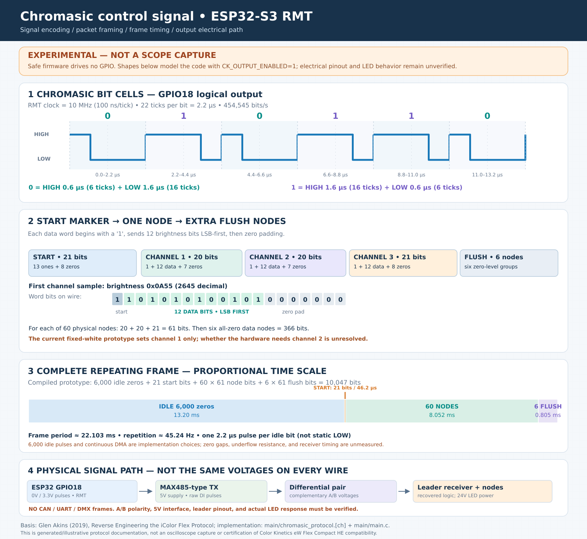

# Chromasic signalling: ESP32-S3 RMT waveform and frame format



> **Status: illustration derived from firmware and published reverse engineering, NOT a logic-analyzer capture.** The default firmware defines `CK_OUTPUT_ENABLED 0` in `main/main.c` and therefore **does not transmit**. Physical LED response, electrical wiring, DMA underrun behavior and uninterrupted waveform are unverified.

## Layer 1 — GPIO18 pulse encoding

Glen Akins' 2019 iColor Flex measurements and the patent he references identify **pulse-width encoding, not UART/DMX/CAN framing**. Each logical bit has a rising edge at the beginning of its approximately 2.2 µs period. Its falling edge encodes the value:

| Logical bit | HIGH | LOW | Total | 10 MHz RMT ticks |
| --- | ---: | ---: | ---: | --- |
| `0` | 0.6 µs | 1.6 µs | 2.2 µs | 6 high + 16 low |
| `1` | 1.6 µs | 0.6 µs | 2.2 µs | 16 high + 6 low |

The nominal bit rate is **454,545 bits/s**, approximately **454.5 kHz**. The on-wire pulse train is continuous in the intended scheme: **idle means repeated encoded zero pulses**, not a static LOW level. The 10 MHz RMT clock gives 100 ns timing resolution. The firmware produces **0–3.3 V GPIO logic** before any external driver; it has not been measured on the ESP32-S3.

The code maps each bit to one `rmt_symbol_word_t` in `main/main.c::ck_rmt_encode`, using `CK_ZERO_HIGH_TICKS=6`, `CK_ZERO_LOW_TICKS=16`, `CK_ONE_HIGH_TICKS=16` and `CK_ONE_LOW_TICKS=6`. It requests DMA-backed RMT transmission with `*done=false` in the encoder callback. **That request is not proof of gap-free operation**: an oscilloscope/logic analyzer and sustained-operation testing are required before using the LEDs.

## Layer 2 — start marker and node data

The published Chromasic framing, as implemented in `main/chromasic_protocol.c::ck_frame_bit`, is:

```text
START  (21 bits): 1111111111111 00000000     [13 ones, 8 zeros]

NODE n (61 bits):
  channel 1  (20 bits): 1 D0 D1 ... D11 0000000
  channel 2  (20 bits): 1 D0 D1 ... D11 0000000
  channel 3  (21 bits): 1 D0 D1 ... D11 00000000

REPEAT node records for nodes 1..60
SEND six additional zero-level node records to flush the daisy chain
```

**Brightness:** 12-bit LSB-first (`D0` transmitted first); normal range `0..4094`. The value `4095` is avoided because its bit pattern can be confused with a start marker. An illustrative channel-1 brightness of `0x0A55` (decimal 2645) encodes as `1 101010100101 0000000`. See `tests/test_chromasic.c` for the corresponding field/order assertions.

The **21-bit last channel** matches the *newer* controller variant identified by Glen. He also observed an older variant in which that channel used 20 bits. The present ESP32 implementation chooses 21 bits, but it has **not** been qualified against the specific eW Flex Compact HE nodes in this project.

**White LEDs:** Glen's measured channels were for iColor Flex RGB nodes. This project's current fixed-white encoder maps the desired white level into **channel 1 only** and forces channels 2 and 3 to zero. Color Kinetics' eW Flex Compact documentation describes two white-light groups/DMX control channels. This mismatch is tracked as an unresolved firmware issue: **do not assume the demonstration reaches full white output**.

## Layer 3 — complete repeating frame

The prototype repeats:

| Frame section | Bits | Approx. duration |
| --- | ---: | ---: |
| Encoded idle zeros | 6,000 | 13.200 ms |
| Start marker | 21 | 0.0462 ms |
| 60 physical nodes × 61 bits | 3,660 | 8.052 ms |
| Six flush nodes × 61 bits | 366 | 0.8052 ms |
| **Total** | **10,047** | **22.1034 ms** |

Nominal frame repetition rate: **45.24 frames/s**. In `main/chromasic_protocol.h` these are `CK_IDLE_BIT_COUNT`, `CK_START_BIT_COUNT`, `CK_BITS_PER_NODE`, `CK_NODE_COUNT`, `CK_FLUSH_NODE_COUNT` and `CK_FRAME_BIT_COUNT`.

Glen measured a roughly **25 ms** control update cadence in one setup; it was the controller's update interval, not a required bit-stream length. The firmware's **6,000 idle zeros** were selected to make a repeating frame about 22 ms long and **are not an independently established protocol requirement**. The 21-bit start code, per-channel framing, and six flush nodes *are* based on his analysis. Because idle zeros are transmitted, the frame above is a **repeating logical representation**, not a traditional packet separated by silence.

## Layer 4 — how the signal reaches the LED string

The **single-ended** signal generated by ESP32-S3 GPIO18 must be adapted to the actual cable interface. In the proposed **four-conductor differential leader** topology:

```text
ESP32 GPIO18 (3.3V logic) → 5V MAX485-class TX logic input (DI)
                         → differential A/B pair on leader
                         → receiver / converter at LED-string end
                         → single-ended Chromasic node data
```

The driver requires a suitable **regulated 5 V supply** and must accept **3.3 V digital HIGH** on DI. Confirm the module's A/B polarity: manufacturer naming differs. Data travels as the raw timing waveform, not serial bytes, CAN frames or DMX commands. The 24 V LED supply is **separate from the data signal**. **Do not connect an unidentified cable conductor to GPIO18**. Connector positions have not been established for this custom harness. See [WIRING.md](WIRING.md) and the [wiring SVG](WIRING_DIAGRAM.svg).

## Verification with an oscilloscope or logic analyzer

1. Use the safe build first; expect **no activity on GPIO18**. Only enable output after electrical interface checks and test equipment are ready.
2. With the LEDs disconnected, probe GPIO18 and verify repeated **2.2 µs** bit cells with the pulse widths in the table. Trigger on a string of long-HIGH pulses to recognize the 13 ones in the start marker.
3. Confirm the A/B differential pair is correctly complementary, and decode the bitstream at the receiver side, respecting its logic polarity.
4. Measure for jitter, missing pulse periods, RMT DMA underruns, and incorrect gaps at frame boundaries over an extended interval; software unit tests do **not** cover this.
5. After driver and power connections are positively identified, attempt a low-brightness single-node trial; then verify both white channels and all 60 nodes.

## References

- Glen Akins, **Reverse Engineering the iColor Flex Protocol**, November 17, 2019: https://bikerglen.com/blog/reverse-engineering-the-icolor-flex-protocol/
- Product information / wiring: https://www.docs.colorkinetics.com/support/datasheets/eW_Flex_Compact_ProductGuide.pdf
- Espressif ESP-IDF v6.1 RMT documentation: https://docs.espressif.com/projects/esp-idf/en/v6.1/esp32s3/api-reference/peripherals/rmt.html
- Local source of truth: [../main/main.c](../main/main.c), [../main/chromasic_protocol.c](../main/chromasic_protocol.c), [../main/chromasic_protocol.h](../main/chromasic_protocol.h)

**Note:** This documentation is an independently written explanation and illustration of publicly described behavior; it does not reproduce Glen's oscilloscope images or establish compatibility with this specific LED batch.
