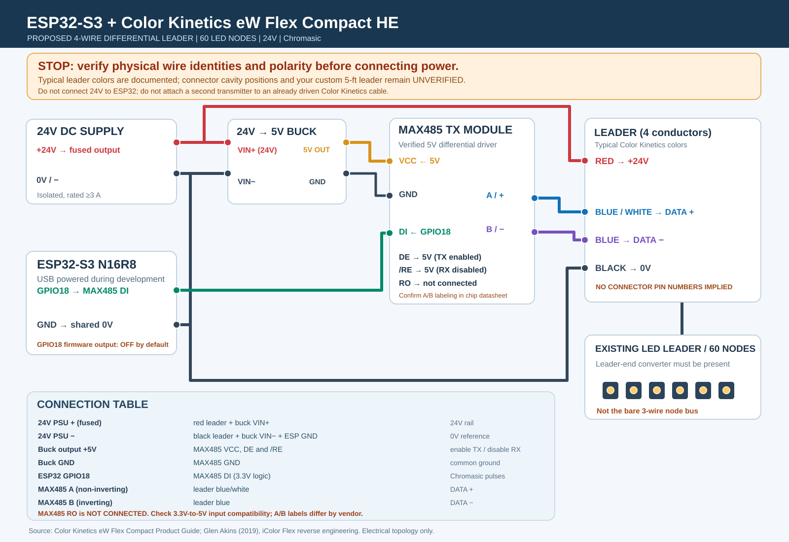

# Provisional ESP32-S3 / eW Flex Compact HE wiring

> STOP: This is an experimental electrical topology, NOT a connector pinout. The pictured 5-foot custom leader and connector cavity orientation have not been measured. Keep power disconnected until each conductor and its destination is independently verified.

## Required hardware

- 24V regulated isolated DC supply rated for at least 3A, with appropriately selected in-line fuse and wiring.
- 24V-to-regulated-5V buck converter for the differential transmitter.
- 5V MAX485-type transmitter module with exposed VCC, GND, DI, DE, /RE, RO, A and B pins; verify its datasheet and logic thresholds.
- ESP32-S3 powered separately through USB during development.
- Compatible original 4-conductor Color Kinetics leader and receiver/converter. This drawing is NOT for a bare 3-wire node cable.

## Proposed connections (after verification)

| From | To |
| --- | --- |
| ESP32 GPIO18 | MAX485 DI |
| ESP32 GND | Common 0V (24V negative / buck ground / MAX485 GND) |
| 24V supply +, through an appropriately rated fuse | Leader RED and buck VIN+ |
| 24V supply negative | Leader BLACK and buck VIN- |
| Buck +5V | MAX485 VCC, DE and /RE |
| Buck GND | MAX485 GND |
| MAX485 A non-inverting output (chip verified) | Leader BLUE/WHITE |
| MAX485 B inverting output (chip verified) | Leader BLUE |
| MAX485 RO | NOT CONNECTED (may be at 5V) |

DE=HIGH enables transmitter; /RE=HIGH disables receiver. MAX485 DIN must recognize ESP32 3.3V HIGH as logic HIGH. Transmit *raw Chromasic pulses* on GPIO18; not UART, Modbus, CAN or DMX serial frames. MAX485-compatible transceiver module names for A and B can vary; consult the exact chip datasheet and confirm differential polarity.

## Safety verification sequence

1. All supplies OFF; identify each actual leader conductor using continuity measurements. Never infer connector cavity numbering or direction from this SVG.
2. Determine whether the leader includes the Color Kinetics receiver/converter or another active transmitter. Never drive an already-driven differential pair.
3. Confirm red/black are the actual 24V power conductors; inspect for shorts. Check the 5V regulator output before connecting the MAX485.
4. Confirm the MAX485 board is powered from 5V and DI accepts 3.3V logic; leave RO disconnected; establish common 0V.
5. Start firmware in safe mode, scope GPIO18/driver differential outputs without connecting LEDs, confirm intended bit timings and continuous waveform.
6. Only after polarity, termination, current limits, power routing and receiver are verified, attach the strand and test one node at low brightness.

Do not add a 120-ohm bus termination resistor until inspecting the actual receiver/leader topology. Do not connect the ESP32 GPIO directly to a 24V conductor.

## Source evidence and limitations

- Product guide: https://www.docs.colorkinetics.com/support/datasheets/eW_Flex_Compact_ProductGuide.pdf
- Independent protocol/leader analysis: https://bikerglen.com/blog/reverse-engineering-the-icolor-flex-protocol/

These sources document a compatible 4-wire leader with red power, black ground, blue inverted data and blue/white non-inverted data. They do **not** verify the custom user-supplied harness or any connector cavity orientation.

**Separate firmware issue:** the eW Flex Compact product guide describes white output on the first two DMX channels (different portions of LEDs); the prototype currently only drives Chromasic channel 1. Investigate before asserting full brightness support.

## Parts and budget

See [BOM.md](BOM.md) for priced examples, estimated costs and procurement hold points. The listed 5 V MAX485 module may contain a 120 Ω termination resistor; inspect it and the existing receiver before using or adding termination. The pictured four-wire connector still requires measurement.
